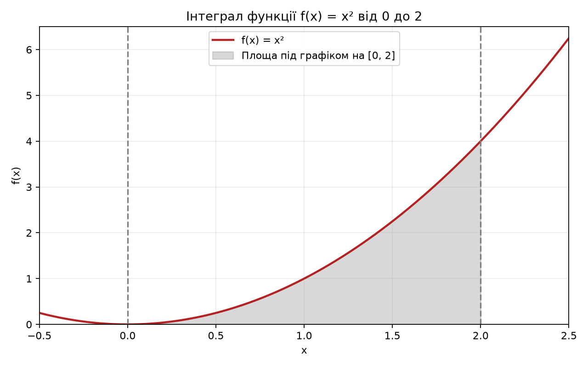

# Домашня робота до тем 9 та 10

**Автор:** Суровикін Олександр Сергійович.

Виконано два завдання: порівняння способів видачі решти та обчислення
інтеграла методом Монте-Карло.

## Файли

- `task_1.py` містить `find_coins_greedy`, `find_min_coins` і порівняння часу.
- `task_2.py` містить обчислення інтеграла, перевірку похибки та побудову графіка.
- `main.py` запускає обидва завдання.
- `integral_plot.png` показує функцію та область інтегрування.
- `requirements.txt` містить залежність для графіка.
- `readme.md` містить пояснення, результати й висновки.
- `.gitignore` виключає службові файли Python.

## Запуск

Потрібен Python 3.10 або новіший. У терміналі з папки проєкту виконайте:

```bash
python -m pip install -r requirements.txt
python main.py
```

Кожне завдання можна запустити окремо:

```bash
python task_1.py
python task_2.py
```

Якщо у вашій системі використовується команда `python3` або `py`, замініть
нею `python`. Завдання 1 працює лише зі стандартною бібліотекою.
Для побудови графіка в завданні 2 потрібна бібліотека Matplotlib.
SciPy не потрібна, оскільки результат перевіряється аналітично.

Графік зберігається поруч із `task_2.py`. Програма не відкриває окреме
вікно з графіком. Повторний запуск оновлює зображення, але не змінює таблиці
цього README: вони містять результати зафіксованого запуску.

## Завдання 1. Видача решти

Номінали монет: `[50, 25, 10, 5, 2, 1]`. Кількість монет кожного номіналу
не обмежена. Функції приймають невід'ємну цілу суму та повертають словник.
Для нульової суми результатом є порожній словник.

Жадібний алгоритм проходить номінали від найбільшого до найменшого.
За допомогою `divmod` він одразу визначає кількість монет певного номіналу
та залишок суми.

Динамічне програмування знаходить найменшу кількість монет для кожної суми
від 0 до заданої. Для кожного номіналу перевіряється, чи можна покращити
результат через уже розв'язану меншу суму. Масив `last_coin` зберігає вибрану
монету та дозволяє відновити відповідь.

Для суми **113** обидві функції повертають:

```python
{50: 2, 10: 1, 2: 1, 1: 1}
```

Перевірка суми: `50 * 2 + 10 + 2 + 1 = 113`. Використано **5 монет**.
Порядок ключів словника не впливає на правильність результату.

### Складність

Позначимо суму як `S`, а кількість номіналів як `k`.

| Алгоритм | Час | Додаткова пам'ять |
|---|---|---|
| Жадібний | O(k) | O(k), включно зі словником відповіді |
| Динамічне програмування | O(S × k) | O(S + k) |

Для фіксованих шести номіналів жадібний алгоритм виконує шість ітерацій,
тому його час майже не залежить від суми. Він записує кількості монет,
а не перебирає кожну монету окремо. Динамічний алгоритм будує два масиви
довжини `S + 1`, тому для великих сум витрачає більше часу та пам'яті.
Оцінки часу наведено у звичайній моделі, де арифметичні операції
вважаються операціями сталої вартості.

### Реальні вимірювання

Перевірено на Python **3.12.14**, `Windows-11-10.0.26200-SP0`.
Час завершення запуску (UTC): `2026-11-07T11:29:52.293789+00:00`.

Використано `timeit.repeat`: 5 серій, по 10 000 викликів жадібної функції
та по 10 викликів динамічної. Час серії поділено на кількість викликів,
після чого взято медіану п'яти значень. Отже, таблиця порівнює час
**одного виклику**, попри різну кількість повторень. Створення масивів
і відновлення відповіді входять у час функції, друк результатів не входить.

| Сума | Жадібний алгоритм, мкс | Динамічне програмування, мкс |
|---:|---:|---:|
| 113 | 0.357 | 31.530 |
| 1000 | 0.323 | 332.040 |
| 10000 | 0.317 | 3252.590 |
| 100000 | 0.339 | 36341.620 |

### Висновок до завдання 1

На перевірених сумах жадібний алгоритм значно швидший. Збільшення суми
майже не змінює кількість його дій. У динамічного алгоритму час зростає
приблизно пропорційно сумі, як і передбачає оцінка O(S × k).

Для цього набору номіналів обидва методи дали мінімальну кількість монет
на перевірених сумах від 0 до 500 і для суми 100 000. Для таких умов
жадібний підхід є практичнішим, особливо при великих сумах.

Для довільного набору номіналів жадібний підхід не гарантує мінімуму.
Наприклад, із монетами `[4, 3, 1]` для суми 6 він вибере `4 + 1 + 1`,
хоча достатньо `3 + 3`. Динамічне програмування корисне, коли важливо
гарантовано знайти мінімальну кількість монет для інших систем номіналів.
У реалізації цього завдання використовується саме заданий набір `COINS`.

## Завдання 2. Інтеграл методом Монте-Карло

Обрано функцію **f(x) = x²** на відрізку **[0, 2]**. Вона невід'ємна,
тому інтеграл дорівнює площі під графіком.



Використано варіант Монте-Карло через середнє значення функції:

1. Згенерувати `N` випадкових точок, рівномірно розподілених на `[a, b]`.
2. Обчислити `f(x)` у кожній точці та знайти середнє значення.
3. Помножити це середнє на довжину відрізка `b - a`.

Формула оцінки: `I ≈ (b - a) * sum(f(x_i)) / N`.
Функція `monte_carlo_integral` повертає числове наближення інтеграла.
Часова складність становить O(N), додаткова пам'ять O(1), оскільки
випадкові точки не зберігаються в масиві. Побудова графіка виконується окремо.

Для відтворюваності використано `random.Random(42)`. У кожному запуску
для нового `N` генератор знову починає з цього seed, тому менші вибірки
є початком більших. Ці рядки таблиці не є незалежними експериментами.

### Аналітична перевірка

Первісна функції `x²` дорівнює `x³ / 3`.

```text
Інтеграл від 0 до 2 = 2³ / 3 - 0³ / 3 = 8 / 3 ≈ 2,6666666667.
```

Абсолютна похибка: `abs(оцінка - 8/3)`.
Відносна похибка у відсотках: `абсолютна похибка / (8/3) * 100`.
Наведені результати отримано реальним запуском програми.

| Кількість точок | Монте-Карло | Абсолютна похибка | Відносна похибка, % |
|---:|---:|---:|---:|
| 1000 | 2.76381471 | 0.09714804 | 3.64305 |
| 10000 | 2.66408283 | 0.00258384 | 0.09689 |
| 100000 | 2.66949385 | 0.00282719 | 0.10602 |
| 1000000 | 2.66594614 | 0.00072053 | 0.02702 |

### Висновок до завдання 2

Для 1 000 000 точок отримано **2.66594614** при точному значенні
**2,6666666667**. Абсолютна похибка становить **0.00072053**,
відносна приблизно **0.02702%**. Результат близький
до аналітичного, що підтверджує правильність реалізації на цьому прикладі.

Похибка не зобов'язана зменшуватися після кожного збільшення кількості точок.
У цьому запуску 100 000 точок дали трохи більшу похибку, ніж 10 000.
Це нормально для випадкового методу. Загалом типовий розмір похибки
зменшується приблизно як `1 / sqrt(N)`, а витрати часу зростають як O(N).
Для приблизного зменшення типової похибки вдвічі потрібно вчетверо більше точок.

Для простої функції `x²` аналітичний спосіб точніший і швидший.
Метод Монте-Карло корисний для складніших задач, де точний розрахунок
незручний або недоступний. Один запуск із фіксованим seed не доводить
точність для всіх можливих випадкових вибірок.

## Перевірка та здача

Перевірено нульову суму, правильність словників, мінімальність кількості
монет, недопустимі аргументи, інтеграл сталої функції, відтворюваність
із фіксованим seed і запуск `main.py`. Графік побудовано з Matplotlib
**3.11.2**.

Назва публічного репозиторію має бути **`goit-algo-hw-10`**.
До LMS потрібно додати посилання на репозиторій та архів
**`ДЗ10_Суровикін_Олександр_Сергійович.zip`**.

У полі здачі також потрібно вказати підхід до оцінювання. Оберіть один
із варіантів відповідно до власного рішення:

- «Обираю перший підхід: погоджуюся з першою отриманою оцінкою,
  якщо вона вища за прохідний бал».
- «Обираю другий підхід: готовий доопрацьовувати роботу за відгуками
  ментора, щоб отримати вищий бал».
